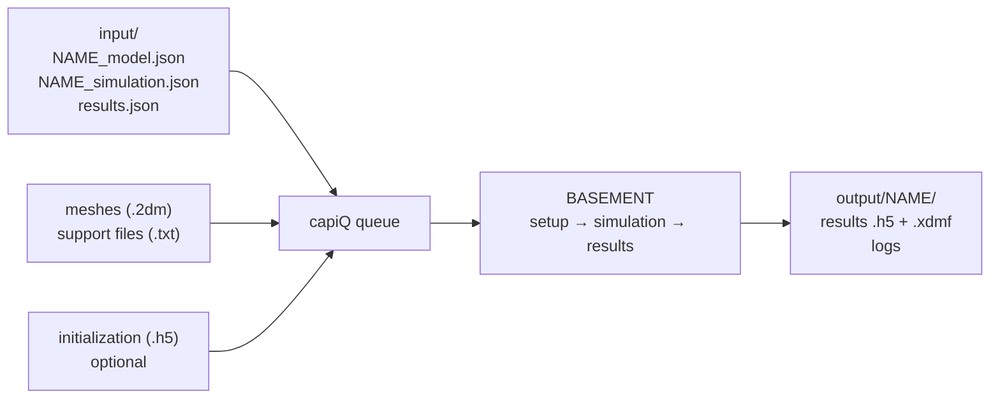

# capiQ

**Computational Automation Pipeline for Hydro-morphodynamic simulation Queues**

capiQ configures, schedules and runs large batches of [BASEMENT](https://basement.ethz.ch) 4.x simulations. You describe every simulation as a pair of input files. capiQ then runs BASEMENT's setup, simulation and results steps for each one. It spreads the queue over your CPU cores and GPUs, and writes every simulation's results to its own folder, ready for ParaView.

## What capiQ does for you

- **Runs a whole queue** from the files in `input/`, one simulation per `NAME_model.json` / `NAME_simulation.json` pair.
- **Runs simulations in parallel** on CPU processes and GPU cards, or one after the other.
- **Finds meshes and discharge files** in the folders you configure, whatever path is written in the model file.
- **Chains simulations**: a scenario can start from the results of another one, which capiQ runs first.
- **Resumes interrupted queues**: after Ctrl+C, a crash or a reboot it skips finished simulations and continues partial ones.
- **Places simulations on multi-socket machines**: each run stays inside one CPU socket, and each GPU run gets its own card.

## How it works

## Where to start

- **New to capiQ?**

    [Install it](getting-started/installation.md), then run the bundled example with the [quick start](getting-started/quickstart.md).

- **Setting up your own project?**

    Read [Configuration](user-guide/configuration.md) and [Input files](user-guide/input-files.md).

- **Looking for a working file to copy?**

    The [Examples](examples/index.md) page walks through every example file, step by step.

- **Queue stopped halfway?**

    See [Resuming a queue](user-guide/resuming.md).

## What the repository contains

| Path | Content |
| --- | --- |
| `src/capiq/` | The capiQ package: I/O, queue creation, queue execution, running BASEMENT, resuming interrupted simulations, placement on CPU sockets and GPUs, utilities. `__main__.py` is the entry point. |
| `user_defined/` | Your configuration: `constants.py` (paths) and `user_options.yml` (how to run). |
| `example_files/` | Example input and support files to use as templates, and a script that creates the example mesh. |
| `run_capiQ.bat` / `run_capiQ.sh` | Launchers for Windows / Linux and macOS. |
| `docs/` | This documentation. |
| `tests/` | Tests that run capiQ with the example files. |
| `pyproject.toml`, `uv.lock` | Package metadata, dependencies and their exact locked versions. |

At run time capiQ also uses `input/` (your simulations) and `output/` (the results) in the project root.

## Supported hydrodynamic software

- BASEMENT 4.x ([references](about/citation.md#references))
