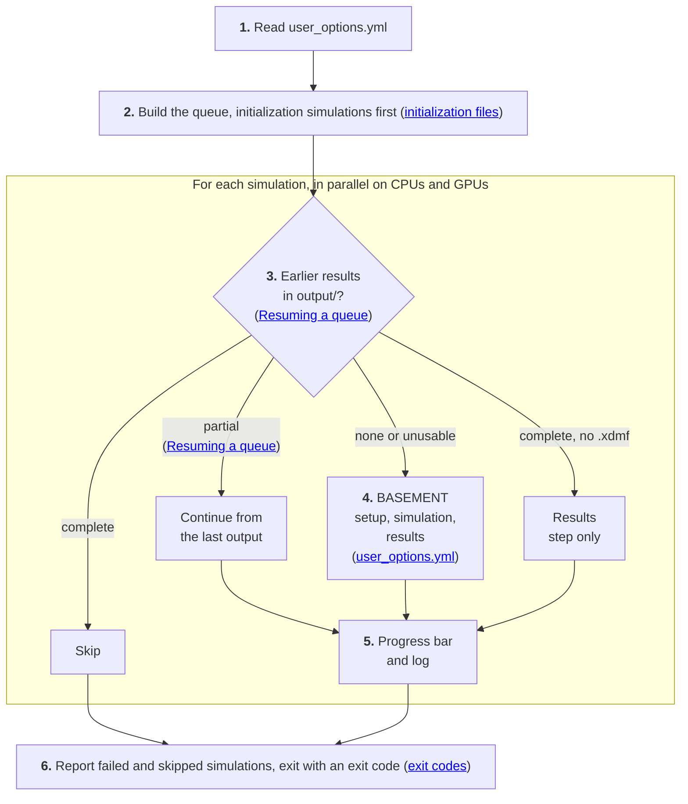

# Running capiQ

## From the project root

capiQ looks for `user_defined/` in the current folder, so start it from the project root:

```bash
uv run python -m capiq
```

Without uv, run `python -m capiq` with the virtual environment activated.

## With the launcher scripts

The launchers change to the project root by themselves, so they can be started from anywhere (or with a double click on Windows):

=== "Windows"

    ```powershell
    run_capiQ.bat
    ```

=== "Linux and macOS"

    ```bash
    ./run_capiQ.sh
    ```

They use uv if it is installed, and otherwise the `.venv` virtual environment in the project root (capiQ must then be installed in it, see [Installation without uv](../getting-started/installation.md#without-uv)).

## Command-line options

Options are passed on by the launchers too.

| Option | Meaning |
| --- | --- |
| `--logger-filename NAME` | Name of the log file. Default: `capiQ_YYYY-MM-DD_HH-MM.log` in the project root. |

```bash
uv run python -m capiq --logger-filename river_run1.log
```

## What happens during a run



## Exit codes

The exit code tells scripts and job schedulers how the queue went, without reading the log:

| Code | Meaning |
| --- | --- |
| `0` | Every simulation ran in this run and succeeded. |
| `1` | Nothing failed, but some simulations were skipped because an earlier run had already completed them (see [Resuming a queue](resuming.md)). |
| `2` | At least one simulation failed, or was skipped because its [initialization simulation](initialization.md) failed. This takes precedence over `1`. |
| `3` | capiQ stopped with an error before or outside the simulations, e.g. an empty `input/`, a missing mesh or initialization file, or an unreadable `user_options.yml`. The message is printed in the terminal, and the full error is in the log. The launcher scripts also return `3` when they find neither uv nor `.venv`. |
| `130` | Stopped with ++ctrl+c++. |

For example, when one simulation fails and three were completed by an earlier run, capiQ prints:

```text
capiQ: 1 simulation(s) failed: SCENARIO_Q002
capiQ: 3 simulation(s) skipped because an earlier run completed them: SCENARIO2_Q001, SCENARIO2_Q002, SCENARIO_Q001
```

and exits with `2`. With an empty `input/`, it stops before running anything and prints the error with the expected folder layout:

```text
capiQ stopped with an error: The input folder …\input is empty.
Add the files, then run capiQ again. The following layout is expected:
...
```

and exits with `3`. The launcher scripts pass the exit code on. To check it after a run:

=== "Windows (PowerShell)"

    ```powershell
    uv run python -m capiq
    echo $LASTEXITCODE
    ```

=== "Linux and macOS"

    ```bash
    uv run python -m capiq
    echo $?
    ```

## Stopping a run

Press ++ctrl+c++. capiQ stops the queue together with the running BASEMENT processes and exits with `130`. Start it again to continue where it stopped: see [Resuming a queue](resuming.md).
